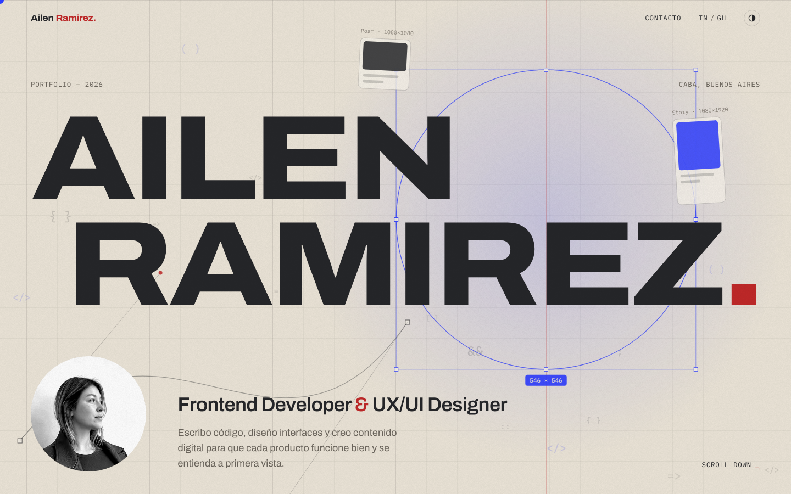

# Ailen Ramirez — Portfolio

**Frontend Developer & UX/UI Designer** · CABA, Buenos Aires

🔗 **[ailurmz.github.io](https://ailurmz.github.io)**



## Sobre el proyecto

Portfolio personal con dirección de arte editorial. El concepto visual se llama **"Capas"**: código, diseño y contenido digital superpuestos y en movimiento, las tres áreas en las que trabajo.

- **Capa código:** grilla tipo blueprint con parallax y fragmentos de sintaxis flotando.
- **Capa diseño:** formas con caja de selección, medidas y curvas Bézier al estilo Figma, que reaccionan al mouse.
- **Capa contenido:** tarjetas de post y story que pasan como un feed.

## Tecnologías

Hecho con **HTML5, CSS3 y JavaScript vanilla**, sin frameworks ni librerías.

- **Canvas 2D API:** fondo animado por capas con distintas profundidades.
- **IntersectionObserver:** apariciones al hacer scroll y contadores animados.
- **CSS Custom Properties:** sistema de color con modo claro y oscuro.
- **Container queries:** mockups hechos en código que escalan con su contenedor.
- **CSS Grid y Flexbox:** layout responsive mobile-first.
- **Accesibilidad:** respeta `prefers-reduced-motion` y `prefers-color-scheme`, foco visible y etiquetas ARIA.

## Estructura

```
├── index.html        Estructura y contenido
├── css/styles.css    Estilos, temas, responsive y animaciones
├── js/main.js        Canvas, cursor, marquee, parallax y scroll
└── assets/           Imágenes
```

## Contacto

- Email: ailuramirezok@gmail.com
- LinkedIn: [ailen-ramirez](https://www.linkedin.com/in/ailen-ramirez-364376161/)
